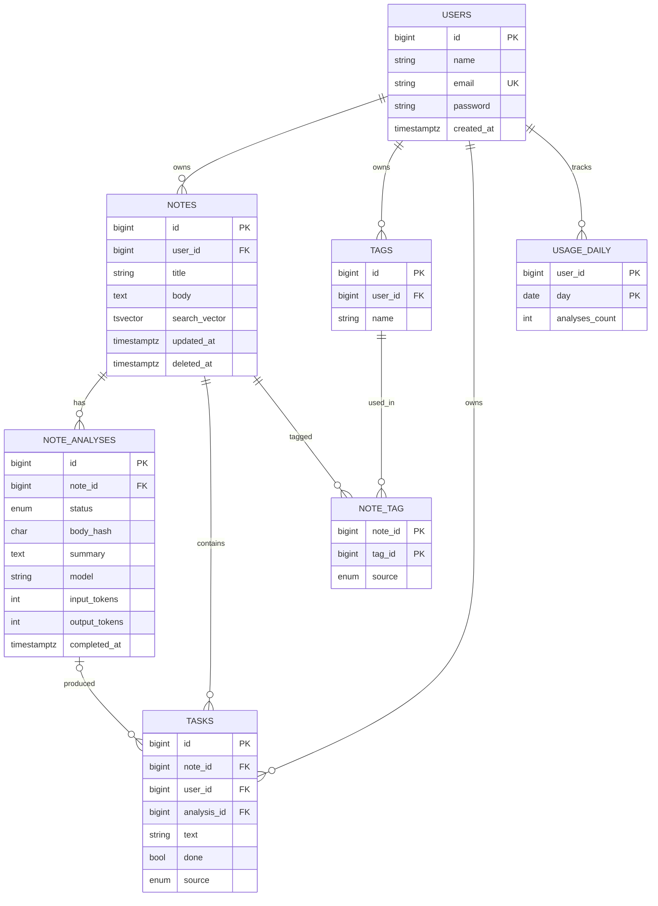

# Database design

Smart Notes uses **PostgreSQL**. The full DDL (tables, indexes, constraints) is in [`schema.sql`](schema.sql) and is ready to run.

Laravel also creates its own framework tables through migrations: `personal_access_tokens` (Sanctum), `jobs` and `failed_jobs` (queue), and `migrations`. They are not part of `schema.sql`.

## Entity relationship diagram



## Tables

| Table | Purpose |
|---|---|
| `users` | Accounts |
| `notes` | User notes, with soft delete and a full-text search column |
| `note_analyses` | One row per AI run: status, summary, model, token usage |
| `tags`, `note_tag` | Per-user tags and the many-to-many link to notes |
| `tasks` | Tasks extracted by the AI or added manually |
| `usage_daily` | Daily count of analyses per user, used for rate limiting |

## Design decisions

| Decision | Reason |
|---|---|
| Separate `note_analyses` table | Each analysis is its own row with a status (`pending`, `processing`, `completed`, `failed`). The mobile app polls it, and it keeps the history and the cost (tokens and model) of every run. |
| `body_hash` on analyses | If a note is edited after analysis, its hash no longer matches, so the app knows the summary is stale and can offer "Re-analyze". |
| Partial unique index on active analyses | Allows at most one `pending` or `processing` analysis per note, so a double tap or a duplicate job cannot start two runs. Enforced by the database, not only by code. |
| `tags` and `note_tag` instead of an array column | Faster search and filtering in the dashboard, and no duplicate tag per user (`UNIQUE (user_id, name)`). |
| Composite foreign key in `tasks` | `(note_id, user_id)` must match a note owned by that user, so a bug in application code cannot attach a task to another user's note. |
| `search_vector` with a GIN index | Fast full-text search over notes. The `simple` configuration is used so Arabic and English both work, without stemming. |
| `usage_daily` | Daily per-user limit on analyses to control LLM cost. |
| Soft delete on `notes` (`deleted_at`) | Lets users recover notes deleted by mistake. |

## Constraints worth knowing

- Note body is limited to 20,000 characters (`CHECK`).
- Deleting a user cascades to their notes, tags, tasks and usage rows.
- Deleting a note cascades to its analyses, tags links and tasks.
- Deleting an analysis keeps its tasks (`analysis_id` is set to `NULL`).
- Authorization still lives in Laravel policies. The composite foreign key is a second layer of defense, not a replacement.

## Applying the schema

```bash
psql "$DATABASE_URL" -f schema.sql
```

In the Laravel project, translate `schema.sql` into migrations so Laravel keeps track of the schema version. Use `DB::statement` for the parts the schema builder does not cover: the generated `search_vector` column, the GIN index, and the partial unique index.

## Minimal start

If you need the smallest possible MVP, begin with `users`, `notes`, `note_analyses` and `tasks`, and add `tags`, `note_tag` and `usage_daily` later.
