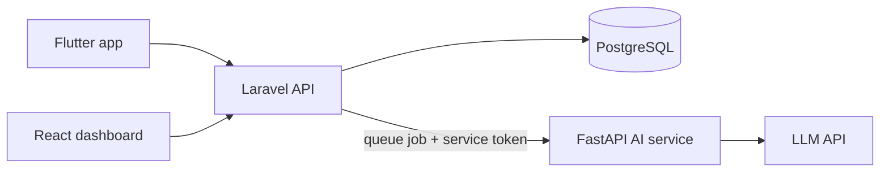

# Smart Notes

AI-powered notes that turn into a summary, tags and a task list with one tap.


> **Status:** in development. This README separates what is built from what is planned, see [Roadmap](#roadmap).

## Overview

Smart Notes is an end-to-end product: a mobile app and a web dashboard on top of one API, with a separate AI service that analyzes notes.

- **Mobile (Flutter):** sign in, write notes, tap **Analyze**, see the result.
- **Web (React):** dashboard with search, tag filters and a task board.
- **API (Laravel):** auth, data, permissions, queue.
- **AI service (FastAPI):** turns note text into structured JSON using an LLM.

## Architecture



Key decisions:

| Decision | Reason |
|---|---|
| Clients talk to Laravel only | Auth, rate limits and ownership checks live in one place |
| FastAPI is internal, not public | Keeps the LLM key and AI logic off the internet-facing surface |
| Analysis runs in a queue | LLM calls take seconds; requests never hang |
| AI output is validated before saving | Never trust model output; reject anything off-schema |
| Results are stored | No repeated LLM calls when a note is reopened |

## Data model

```
notes   id, user_id, title, body, summary, tags[], analyzed_at, created_at, updated_at
tasks   id, note_id, user_id, text, done, created_at
```

## AI service contract

`POST /analyze` (internal, requires service token)

```json
// request
{ "text": "note body..." }

// response
{
  "summary": "short summary",
  "tags": ["tag1", "tag2"],
  "tasks": ["task 1", "task 2"]
}
```

Laravel validates the response shape before writing to the database.

## API (planned)

| Method | Endpoint | Purpose |
|---|---|---|
| POST | `/api/auth/register`, `/api/auth/login` | Authentication (Sanctum) |
| GET/POST | `/api/notes` | List and create notes |
| PUT/DELETE | `/api/notes/{id}` | Update and delete |
| POST | `/api/notes/{id}/analyze` | Queue an analysis |
| GET | `/api/notes/{id}` | Note with analysis status and result |
| PATCH | `/api/tasks/{id}` | Mark a task done |

## Security

- Laravel policies: a user can only read and change their own notes and tasks.
- The LLM API key exists only in the AI service environment.
- Laravel to FastAPI calls use a shared service token over the internal network.
- Per-user daily limits on analyses to control cost.
- Input length limits on notes sent to the model.

## AI-assisted development

The architecture, data model and decisions are designed by me. Most code is generated with AI, then verified by:

- automated tests and CI on every change,
- review of security-sensitive parts (permissions, service-to-service auth) by teammates,
- typed schemas at every service boundary.

## Getting started

Prerequisites: Docker and Docker Compose.

```bash
git clone <repo-url>
cd smart-notes
cp .env.example .env     # set values listed below
docker compose up --build
```

Environment variables (`.env`):

| Variable | Used by | Description |
|---|---|---|
| `DB_*` | Laravel | Database connection |
| `AI_SERVICE_URL` | Laravel | Internal URL of the FastAPI service |
| `AI_SERVICE_TOKEN` | Laravel, FastAPI | Shared secret for internal calls |
| `LLM_API_KEY` | FastAPI | LLM provider key |

## Project structure

```
smart-notes/
├── api/        Laravel API
├── ai/         FastAPI AI service
├── web/        React dashboard
├── mobile/     Flutter app
└── docker-compose.yml
```

## Evaluation

Quality of summaries and task extraction will be measured on a labeled test set.

| Metric | Result |
|---|---|
| Test set size | coming soon |
| Task extraction quality | coming soon |

## Roadmap

- [ ] Laravel API: auth, notes CRUD, policies
- [ ] Flutter app: login, notes, analyze button
- [ ] FastAPI `/analyze` with schema validation
- [ ] Queue integration and analysis status
- [ ] React dashboard and landing page
- [ ] Evaluation set and metrics
- [ ] Agent with tools (read-only first, confirmation for changes)
- [ ] Deployment and store release

## Author

Ehab Kamal Kamel Amin · [LinkedIn](https://linkedin.com/in/ehab-elshimi-b76b0a149)
